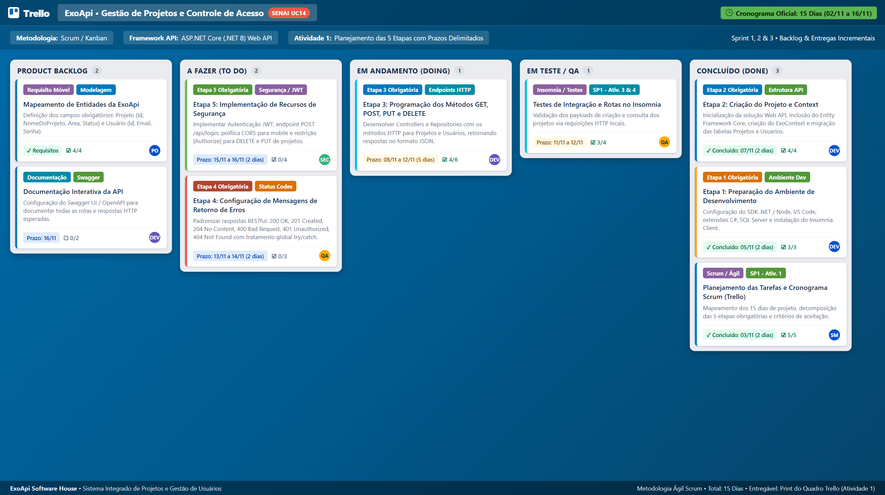

# UC14 - Desenvolvimento de APIs (SENAI) • Projeto ExoApi Completo

Repositório oficial contendo a resolução integral de **todas as atividades (1 a 6)** da situação-problema da empresa **ExoApi**, desenvolvidas para atender aos critérios da Unidade Curricular **UC14 - Desenvolvimento de APIs**.

---

## 📌 Visão Geral das Atividades Desenvolvidas

| Atividade | Descrição Oficial (SENAI) | Artefato / Implementação Entregue | Status |
| :---: | :--- | :--- | :---: |
| **SP1 - Ativ. 1** | **Planejar as tarefas com metodologia ágil Scrum** | Quadro visual Trello ([`quadro_trello_exoapi.png`](quadro_trello_exoapi.png)) + Documento de Sprints ([`PLANEJAMENTO_SCRUM_EXOAPI.md`](PLANEJAMENTO_SCRUM_EXOAPI.md)) | ✅ 100% |
| **SP1 - Ativ. 2** | **Quiz - Métodos de requisição HTTP (GET, POST, PUT, PATCH, DELETE)** | Guia teórico + Gabarito comentado com 8 questões simuladas ([`ATIVIDADE_2_QUIZ_METODOS_HTTP.md`](ATIVIDADE_2_QUIZ_METODOS_HTTP.md)) | ✅ 100% |
| **SP1 - Ativ. 3** | **Criar estrutura da API com Context e método GET para projetos** | Model `Projeto`, `ExoContext`, `ProjetoRepository` e endpoint `GET /api/projetos` | ✅ 100% |
| **SP1 - Ativ. 4** | **Criar restante do CRUD de projetos e testar no Insomnia** | Métodos `POST`, `PUT`, `PATCH`, `DELETE` + Collection pronta ([`Insomnia_ExoApi_Collection.json`](Insomnia_ExoApi_Collection.json)) | ✅ 100% |
| **SP1 - Ativ. 5** | **Criar CRUD de usuários** | Model `Usuario`, `UsuarioRepository` e endpoints `GET`, `POST`, `PUT`, `DELETE /api/usuarios` | ✅ 100% |
| **SP1 - Ativ. 6** | **Criar método de Login com JWT e configurar CORS** | Controller de `Login` (`POST /api/login`), geração de Token JWT, CORS habilitado e proteção `[Authorize]` | ✅ 100% |

---

## 🖼️ Atividade 1: Quadro Scrum no Trello

Quadro com as **5 etapas obrigatórias** e os **prazos delimitados** para entrega da API ao longo dos 15 dias:



---

## 💻 Estrutura do Código-Fonte da API

O projeto foi disponibilizado em duas implementações completas:

### 1. Solução Oficial em C# / ASP.NET Core (`Exo.WebApi/`)
Estrutura exigida pelos professores do SENAI:
```text
Exo.WebApi/
├── Controllers/
│   ├── ProjetosController.cs   # Endpoints CRUD de Projetos (PUT e DELETE protegidos)
│   ├── UsuariosController.cs   # Endpoints CRUD de Usuários
│   └── LoginController.cs      # Autenticação e emissão do Token JWT
├── Contexts/
│   └── ExoContext.cs           # DbContext do Entity Framework Core
├── Models/
│   ├── Projeto.cs              # Id, NomeDoProjeto, Area, Status
│   └── Usuario.cs              # Id, Email, Senha
├── Repositories/
│   ├── ProjetoRepository.cs    # Métodos de acesso aos dados de projetos
│   └── UsuarioRepository.cs    # Métodos de acesso aos dados e login de usuários
├── ViewModels/
│   └── LoginViewModel.cs       # Validação de payload de login
├── Program.cs                  # Injeção de dependência, CORS, JWT Bearer e Swagger
└── appsettings.json            # Configurações e Connection String
```

### 2. Servidor Executável Imediato em Node.js (`server.js`)
Para testar os endpoints imediatamente sem necessidade de compilação:
```bash
# 1. Iniciar o servidor da API:
npm start

# 2. Executar a bateria de testes automatizados de todos os endpoints:
node test_api.js
```

---

## 🚀 Como Testar no Insomnia (Atividade 4)

1. Abra o **Insomnia**.
2. Clique em **Import** e selecione o arquivo [`Insomnia_ExoApi_Collection.json`](Insomnia_ExoApi_Collection.json).
3. Todas as requisições estarão organizadas por pastas:
   - **Autenticação:** `POST /api/login` (gera o token JWT).
   - **Projetos:** `GET`, `POST`, `PUT` (protegido com Bearer Token) e `DELETE` (protegido).
   - **Usuários:** `GET`, `POST`, `PUT`, `DELETE`.

---

## 🗄️ Banco de Dados SQL Server (`SQL/ExoApi_Database.sql`)

Para criar a base no SQL Server Management Studio (SSMS):
1. Abra o arquivo [`SQL/ExoApi_Database.sql`](SQL/ExoApi_Database.sql).
2. Execute o script para criar a database `ExoApi`, as tabelas `Projetos` e `Usuarios`, e a carga inicial de dados.
